# Choose your Orbit interface

Orbit Store 1.3.0 and Orbit Zero 1.3.0 offer four interfaces: **Store**, **Crossbar**, **Cinema** and **Panorama**. For the native PS5 app, use **1.6.0**, included in the same release. Each changes the layout and navigation while keeping your catalogue, favourites and download queue.

## Switch interfaces

| Where you use Orbit | Open Appearance |
| --- | --- |
| Native PS5 app using Store | **App settings → Appearance** |
| Native PS5 app using Crossbar, Cinema or Panorama | **Settings → Appearance** |
| Browser using Store | **App settings → Appearance** |
| Browser using Crossbar, Cinema or Panorama | **Settings → Appearance** |
| Orbit Zero using Store | The palette-shaped **Appearance** button in the top bar |
| Orbit Zero using Crossbar, Cinema or Panorama | **Settings → Appearance** |

Choose an interface, then select **Keep Store**, **Keep Crossbar**, **Keep Cinema** or **Keep Panorama** when **Keep this interface?** appears. You have **15 seconds** to confirm. **Switch back**, or letting the countdown finish, returns to your previous interface.

To return to the default later, open Appearance again, choose **Store** and confirm **Keep Store**. Switching does not pause downloads or change their source or destination.

## Compare the layouts

| Interface | Layout |
| --- | --- |
| **Store (default)** | A familiar top navigation bar, featured artwork, game rows and grids. |
| **Crossbar** | Horizontal categories with vertical lists over a ribbon background. |
| **Cinema** | Large artwork, prominent titles and filmstrip-style game collections. |
| **Panorama** | Wide sections, bold headings and groups of tiles with a choice of accent colours. |

### Store

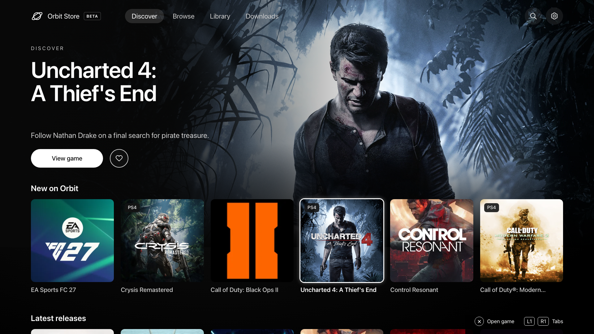

### Crossbar

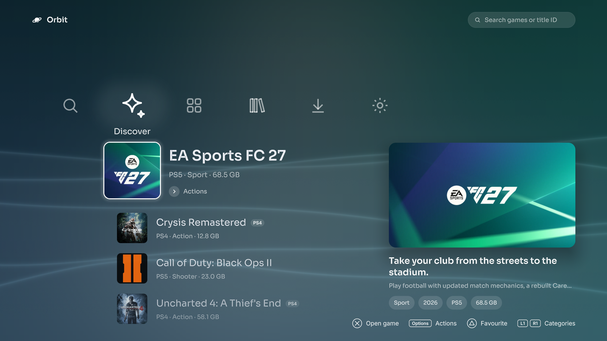

See more: Browse, game details and Downloads in Crossbar

**Browse**

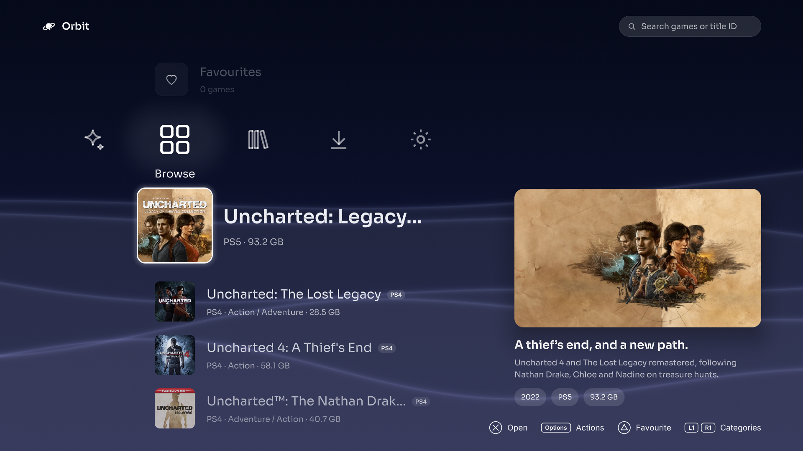

 

**Game details**

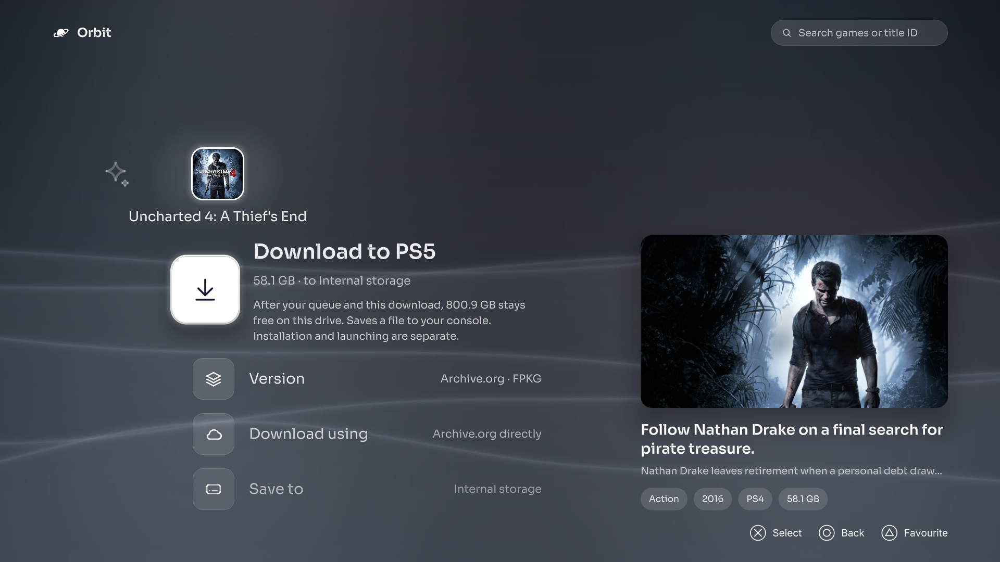

 

**Downloads**

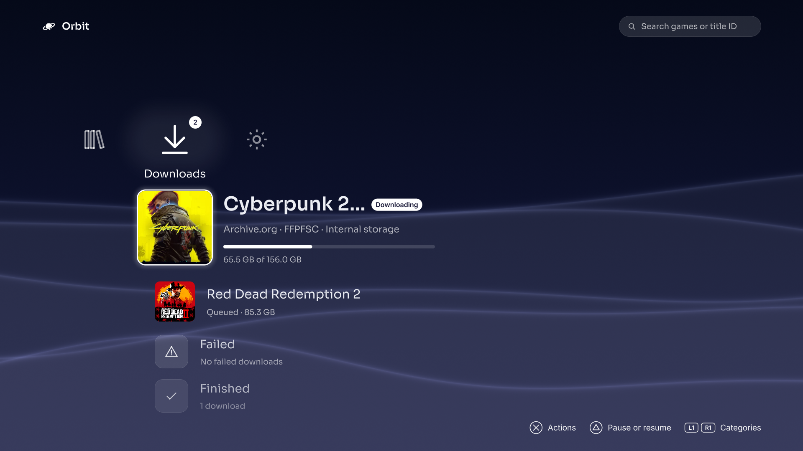

*Download progress and storage in these previews are illustrative.*

### Cinema

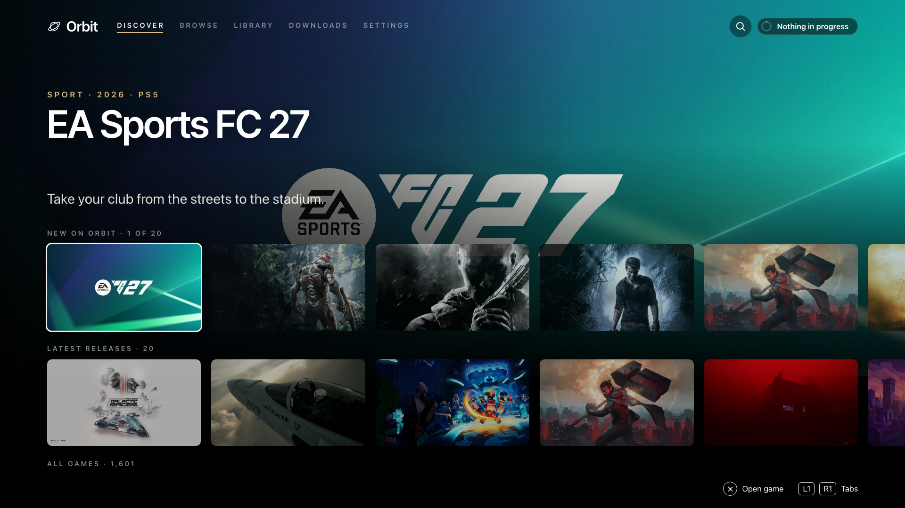

See more: Browse, game details and Downloads in Cinema

**Browse**

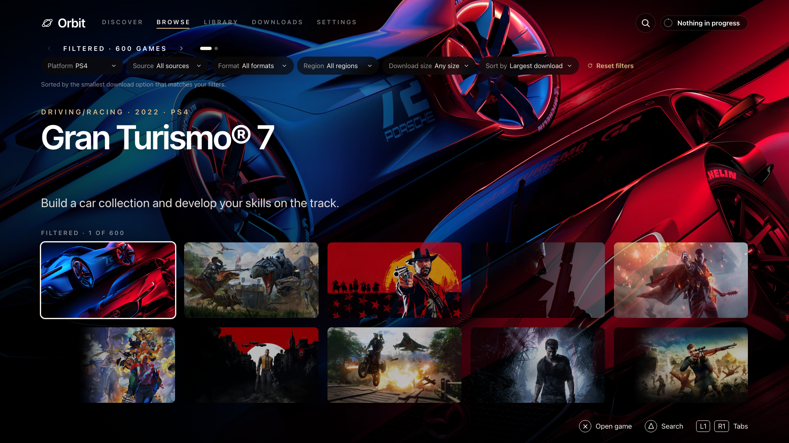

 

**Game details**

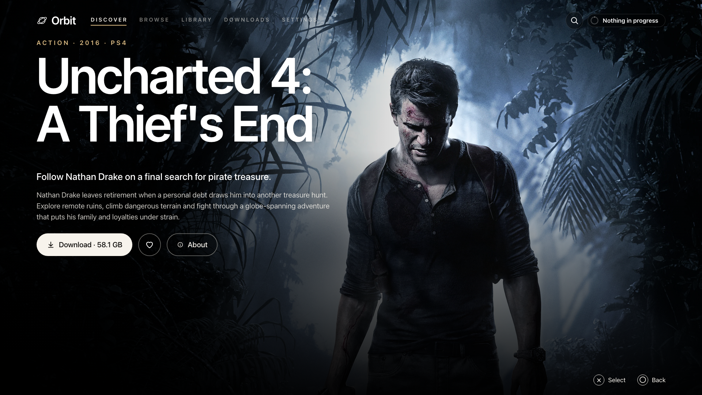

 

**Downloads**

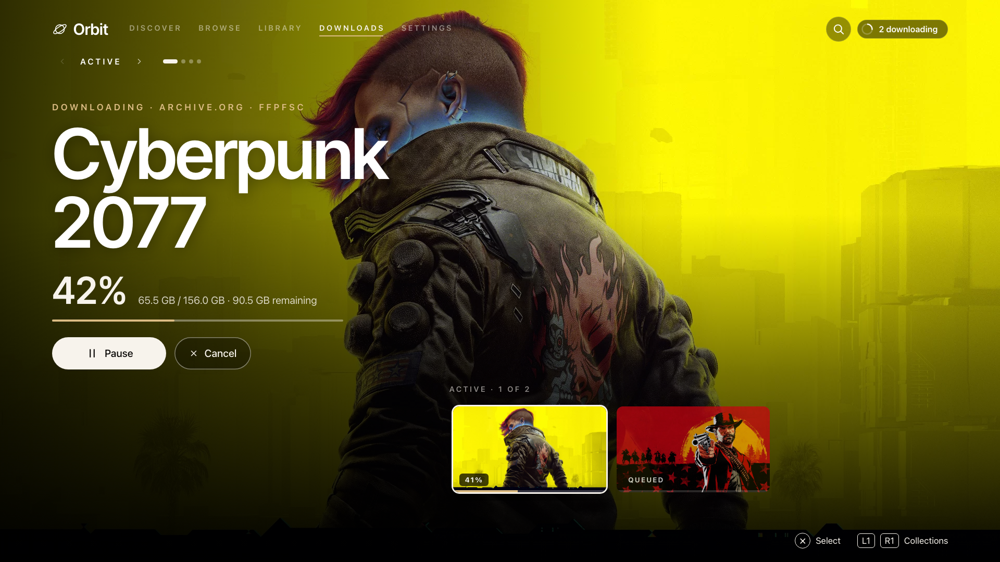

*Download progress and storage in these previews are illustrative.*

### Panorama

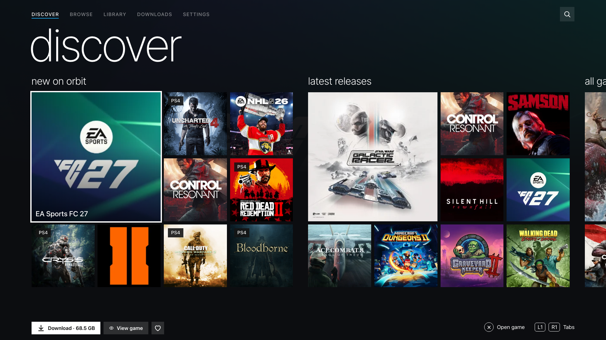

See more: Browse, game details and Downloads in Panorama

**Browse**

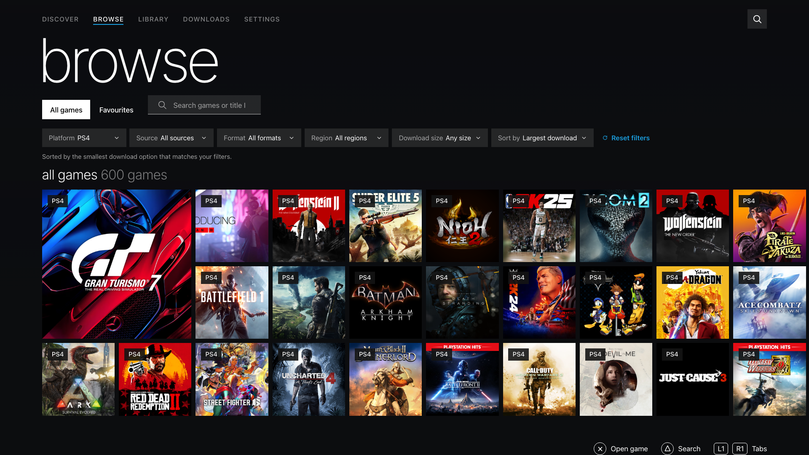

 

**Game details**

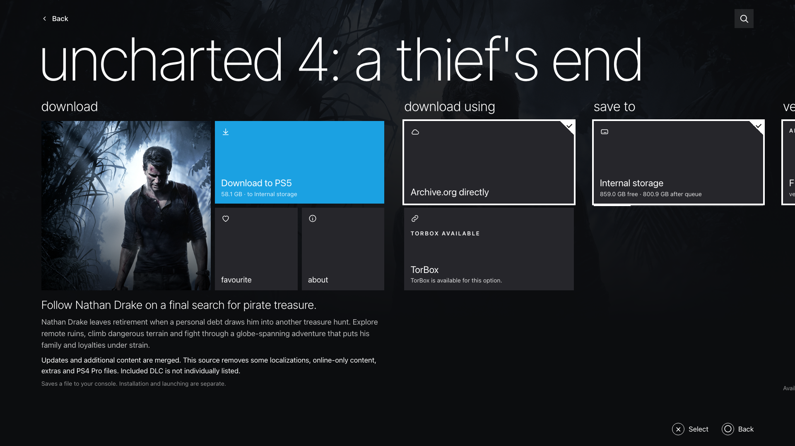

 

**Downloads**

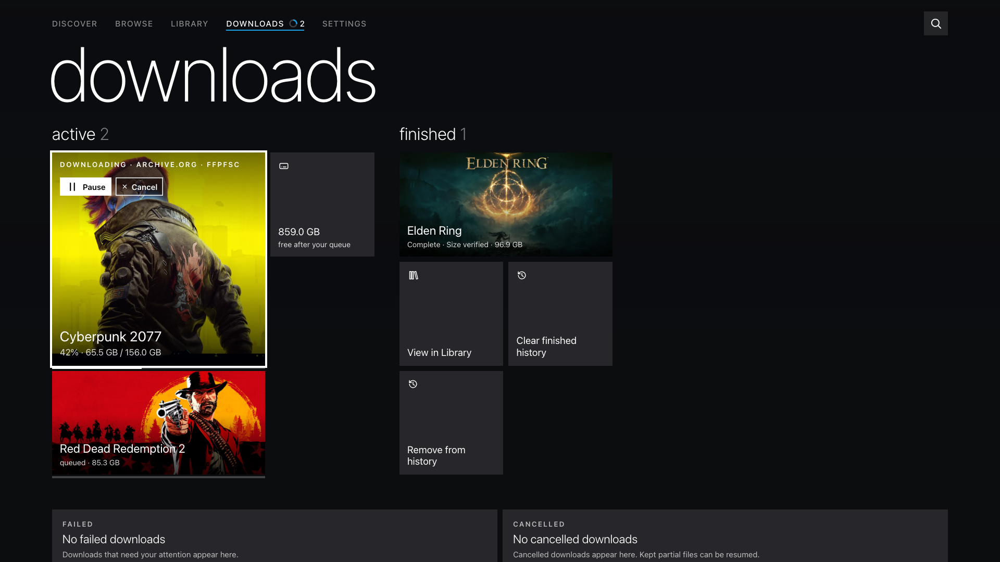

*Download progress and storage in these previews are illustrative.*

*These previews were rendered locally from the released app code. Crossbar shows the native app; Store, Cinema and Panorama show the browser interface. Orbit Zero offers the same four choices.*

## Motion and backgrounds

Open **Appearance** while using the interface you want to adjust. Available options depend on that interface.

| Interface | Options |
| --- | --- |
| All four | **Motion → Full** or **Reduced**. Reduced limits animated movement; it does not change downloads. |
| Crossbar | **Ribbons → Follow the time of day**, **Dawn**, **Day**, **Dusk** or **Night**. Reduced motion keeps the ribbons still. |
| Cinema | **Art behind menus → Blurred game art** or **Plain black**. Reduced motion keeps the art still. |
| Panorama | **Accent colour → Blue**, **Magenta**, **Green** or **Orange**; **Art behind pages → Faint game art** or **Plain black**. |

Choose **Reduced** if you prefer less movement. In Cinema or Panorama, **Plain black** also removes the background art behind menus or pages. Game covers and details still use the game's artwork.

## Controller navigation in the native app

Use the D-pad or left stick to move, **Cross** to select and **Circle** to go back. Follow the button hints on the current screen: shortcuts differ between interfaces.

| Interface | Navigation and favourites |
| --- | --- |
| Store | **L1/R1** switches tabs. In Browse and Discover, **Square** adds or removes the selected game from favourites. |
| Crossbar | At the main category bar, **Left/Right** changes category and **Up/Down** moves through its list. **L1/R1** also switches categories. **Triangle** toggles a selected game's favourite. |
| Cinema | Move **Up** to the navigation bar, then use **Left/Right** to reach another section. **L1/R1** moves through the current chapter or collection before changing sections. **Triangle** toggles a selected game's favourite. Use **Browse** for search. |
| Panorama | Move through tile groups with the D-pad; **L1/R1** moves through page groups or settings sections before changing the main section. **Triangle** toggles a selected game's favourite. |

Dialogs and menus have their own controls. While **Keep this interface?** is open, choose whether to keep or revert the layout before navigating the page behind it.

## Find settings after switching

Instructions elsewhere in these guides usually name the **Store** controls. The native app calls **App settings** simply **Settings** in the other interfaces, with the same settings sections inside. In the browser's other interfaces, use the **Settings** page:

| Browser Store control | Crossbar, Cinema or Panorama |
| --- | --- |
| Sources | **Settings → Download sources** |
| Storage | **Settings → Storage and downloads** |
| Pair devices | **Settings → Pair devices** |
| App settings → Appearance / Language / Game catalogue | **Settings → Appearance / Language / Game catalogue** |
| App settings → Update / reinstall | **Settings → Updates** |
| App settings → TV app | **Settings → TV app** |
| App settings → Debrid | **Settings → TorBox** |
| App settings → Payload managers / Start automatically / Diagnostics | The same section under **Settings** |

In **Orbit Zero**, Store's top-bar **Appearance**, **Language** and **Updates** controls move into **Settings** in the other interfaces. Computer download preferences and cache cleanup are also available under **Settings → Download settings** and **Settings → Computer cache**. **Console** still contains your PS5 connection and download-route preference.

The layouts use the same available games and enabled sources. Browse still provides search and filters; Downloads still manages the queue. Scroll through longer lists or grids to reveal more games.

## Where your choice is saved

Confirming an interface saves it for that app or browser. Native Orbit, the PS5 browser, a paired phone and Orbit Zero can each use a different layout. They do not sync appearance choices with one another.

In a browser, the preference belongs to that browser profile and address. Opening Orbit by a different IP address or hostname can start with Store again. Clearing site data or using a private session can also reset it. An unavailable browser storage setting may prevent the choice from surviving a restart.

If your choice switches back immediately, select **Keep** before the confirmation countdown ends. If the Appearance controls are missing, update the app you are using from the [latest release](https://github.com/saawant12/orbit-store-ps5/releases/latest); updating only the catalogue does not install new interfaces.

Missing artwork can be a network or image-host problem. Changing interfaces does not fix an unavailable image. See [artwork troubleshooting](troubleshooting.md#a-game-or-image-is-missing).

[Getting started](getting-started.md) · [Download guide](downloads.md) · [Orbit Zero](orbit-zero.md) · [Troubleshooting](troubleshooting.md) · [Project home](../README.md)
